# Lucky 37 – LB1 Portfolio (Teil 1)

> **AI-Hinweis:** Für dieses Dokument kam Claude Sonnet 5.5 von Anthropic zum Einsatz.

## 1. Titelseite

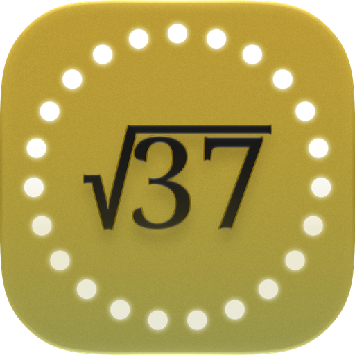

|  |  |
|---|---|
| **Produkt** | Lucky 37 – Roulette-App für iOS |
| **Dokument** | LB1 Portfolio, Teil 1 (Design) |
| **Modul** | 322 – Benutzerschnittstellen entwerfen und implementieren |
| **Name** | Niklas Baumgartner |
| **Klasse** | INF2025i |
| **Datum** | 21.11.2026 |
| **Version** | 1.0 |
| **Wiedererkennungsmerkmal** | Goldene App-Icon-Kachel mit «√37» und Punktering |
| **GitHub-Repository** | [github.com/IveNooName/m322](https://github.com/IveNooName/m322) |

## 2. Auftraggeber

Auftraggeber ist die frei erfundene Fortuna Labs GmbH, ein kleines Zürcher Indie-Studio für Casino-Simulationen ohne Echtgeld.

|  |  |
|---|---|
| **Name** | Fortuna Labs GmbH |
| **Ort** | Zürich (Büro im Kreis 5) |
| **Firmengrösse** | 9 Mitarbeitende: 4 Entwicklung, 2 Design, 1 Produkt, 1 Marketing, 1 Geschäftsleitung |
| **Geschäftsgebiet** | Entwicklung kostenloser Casino-Simulationen mit Spielgeld für Smartphones. Es gibt keine Einzahlung, keine Auszahlung und keine Kreditkarte. |
| **Kunden** | Privatpersonen im deutschsprachigen Raum, die Casinospiele ohne finanzielles Risiko ausprobieren wollen |
| **Marktanteil** | Rund 40'000 Downloads der bisherigen Titel in der Schweiz. Das ist eine Nische, in der internationale Anbieter dominieren. |
| **Zielgruppe** | Gelegenheitsspieler und Casino-Interessierte, 16 bis 45 Jahre, die Nervenkitzel ohne Kosten suchen |
| **Wirtschaftliche Ziele** | Reichweite aufbauen, später Einnahmen über kosmetische Themes und Sponsoring. Mit Spielgeld entfällt die Zahlungsabwicklung. |
| **Rechtliche Einschätzung** | Die AGB verlangen «ab 18 Jahren», eine Altersprüfung findet nicht statt. Fortuna Labs versteht das Produkt als Simulation, nicht als Geldspiel. |

Die rechtliche Einschätzung ist die Sicht des Auftraggebers, keine Rechtsauskunft.

## 3. Fallbeispiel: Lucky 37

Lucky 37 ist ein europäisches Roulette (Zahlen 0 bis 36) mit Spielgeld, gebaut als native iOS-App für das iPhone.

|  |  |
|---|---|
| **Name** | Lucky 37 |
| **Thema** | Roulette mit virtuellen Chips. Kein Echtgeld, keine Registrierung mit Zahlungsdaten, keine Einzahlung. |
| **Ziel des Nutzers** | Schnell einen Einsatz setzen, den Spin erleben und den Verlauf im Blick behalten, ohne finanzielles Risiko |
| **Typischer Ablauf** | App öffnen, Tisch wählen, Chips setzen, Einsatz prüfen, Spin auslösen, Ergebnis ansehen, Verlauf prüfen, nächste Runde |
| **Nutzungsumfeld** | Privat, meist abends auf dem Sofa, im Bett oder unterwegs im ÖV. Das iPhone wird im Hochformat gehalten, oft einhändig. |
| **Aufgaben des Produkts** | Einsatz erfassen und validieren, Spin ausführen, Ergebnis anzeigen, Verlauf auflisten, Spielgeld-Guthaben verwalten, Hilfe (FAQ) und Anbieterinfos bereitstellen |
| **Besonderheit** | Der Einstieg ist bewusst reibungslos: ohne Kreditkarte, ohne Altersabfrage, ohne Konto. Auf einem Familienkonto bleibt dadurch keine Spur. |
| **Barrierefreiheit** | Fokus auf Farbsehschwäche (Rot und Grün tragen nie allein eine Information), ausreichenden Kontrast, grosse Touch-Ziele und reduzierbare Animationen. Screenreader-Unterstützung ist nicht im Umfang. |
| **Entwurfsentscheid** | Es werden bewusst keine Spielerschutz-Funktionen (Limits, Selbstsperre) eingebaut, weil kein Echtgeld im Spiel ist. Die Begründung steht bei den Anforderungen. |

### Primäre Zielplattform

**iOS (iPhone), Hochformat.** Referenzgerät für Layout und Mockups ist ein iPhone mit 402 × 874 pt Bildschirm. Getestet wird im Xcode-Simulator und auf einem iPhone im Entwicklermodus. Für Teil 2 ist die Umsetzung mit Avalonia vorgesehen.

## 4. Nutzeranalyse

Die Zielgruppe von Lucky 37 sind technikaffine Gelegenheitsspieler zwischen 16 und 45 Jahren, die Nervenkitzel ohne finanzielles Risiko suchen. Alle Zahlen sind fiktive Annahmen des Auftraggebers.

### Zielgruppe im Überblick

| Merkmal | Ausprägung |
|---|---|
| **Alter** | 16 bis 45 Jahre, Schwerpunkt 17 bis 40 |
| **Geschlecht** | ca. 70 % männlich, ca. 30 % weiblich |
| **Finanzielle Verhältnisse** | breit gestreut, aber bewusst geringe Zahlungsbereitschaft, weil die App gratis ist |
| **Sozialer Status** | Lernende, Studierende und Berufstätige |
| **Peergruppen** | Kollegen, Casino-Streams und -Videos, Arbeitskollegen |
| **Wohnsituation** | Elternhaus, WG oder eigene Wohnung |
| **Ausbildung** | EFZ in Ausbildung bis Berufsausbildung mit Weiterbildung |
| **Interessen** | Casino-Kultur, Tisch- und Kartenspiele, Streams, Nervenkitzel |
| **Technisches Verständnis** | durchschnittlich bis hoch (Smartphone-Alltag) |
| **Besonderheit** | Ein Teil der Nutzer hat eine Rot-Grün-Sehschwäche (rund 8 % der Männer). Das betrifft Roulette direkt, weil Rot, Schwarz und die grüne Null unterschieden werden müssen. |

### Altersverteilung (fiktive Annahme)

| Altersgruppe | Anteil |
|---|---|
| 16 bis 19 Jahre | 20 % |
| 20 bis 29 Jahre | 35 % |
| 30 bis 39 Jahre | 30 % |
| 40 Jahre und älter | 15 % |

### Die beiden Hauptnutzer im Vergleich

| Merkmal | Nico (Persona 1) | Daniel (Persona 2) |
|---|---|---|
| **Alter** | 17 | 38 |
| **Geschlecht** | männlich | männlich |
| **Finanzen** | Lehrlingslohn, kaum Spielraum, keine eigene Kreditkarte | solides Einkommen, will kein Echtgeld mehr einsetzen |
| **Sozialer Status** | Lernender, lebt bei den Eltern | Teamleiter, Familie |
| **Peergruppe** | Kollegen, Casino-Streams und -Videos | Arbeitskollegen, Freundeskreis |
| **Wohnsituation** | Elternhaus, eigenes Zimmer | eigene Wohnung |
| **Ausbildung** | EFZ (in Ausbildung) | Berufsausbildung plus Weiterbildung |
| **Interessen** | Zocken, Streams, Nervenkitzel | Casino-Kick, Poker, Sport |
| **Technikverständnis** | hoch | durchschnittlich |
| **Besonderheit** | will unauffällig spielen | Rot-Grün-Sehschwäche |

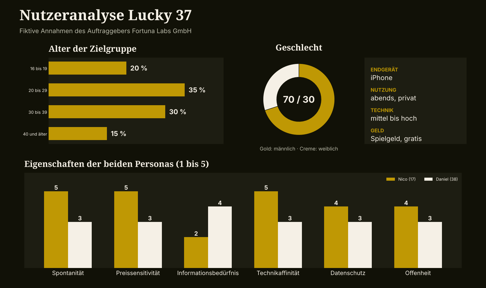

## 5. Personas und Interviews

Nico will ohne Spuren und ohne Hürden spielen, Daniel will den Kick ohne Reue und braucht dafür eine Oberfläche, die er trotz Rot-Grün-Sehschwäche sicher bedient. Beide sind frei erfunden.

### Persona 1: Nico

**Nico, 17, aus Thun, Lernender Detailhandel im 2. Lehrjahr**

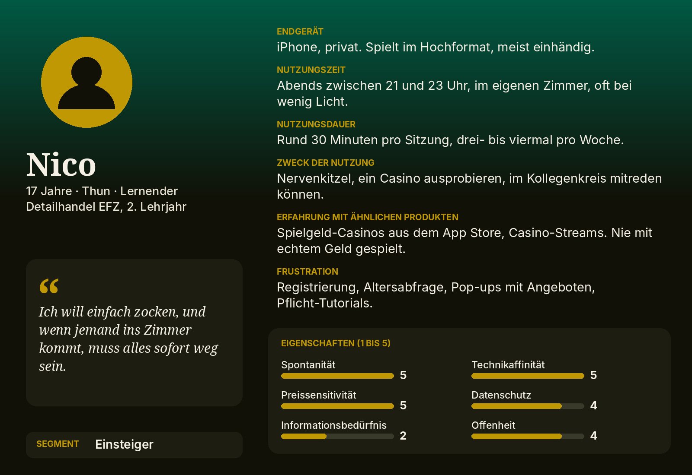

> «Ich will einfach mal ‹All in› sagen, ohne dass irgendwer etwas davon merkt.»

|  |  |
|---|---|
| **Ziel** | Roulette spielen, ohne Zahlung und ohne Wissen der Eltern. Er will wissen, wie sich ein Casino-Tisch anfühlt, bevor er mit 18 vielleicht echt spielt. |
| **Situation** | Sitzt abends in seinem Zimmer am iPhone, oft nach dem Training oder nach der Arbeit. Die App ist gratis, es gibt keinen Kauf und damit keine Spur auf dem Familienkonto. |
| **Bedürfnisse** | Sofort loslegen, ohne Registrierung, Altersabfrage oder Kreditkarte. Eine selbsterklärende Bedienung, ohne Tutorial. Keine Benachrichtigungen, die ihn verraten könnten. |
| **Motivation** | Nervenkitzel, Neugier und «mitreden können» im Kollegenkreis, der Casino-Streams schaut |
| **Frustration** | Apps, die nach Alter, Kreditkarte oder E-Mail fragen. Lange Ladezeiten, Pflicht-Tutorials und Werbung. |

| Eigenschaft | Wert (1 bis 5) |
|---|---|
| Spontanität | 5 |
| Preissensitivität | 5 |
| Informationsbedürfnis | 2 |
| Technikaffinität | 5 |
| Datenschutz | 4 |
| Offenheit | 4 |

**Segment:** Einsteiger (geringe Casino-Kenntnisse, hohe Nutzungshäufigkeit)

### Persona 2: Daniel

**Daniel, 38, aus Winterthur, Teamleiter Logistik, Rot-Grün-Sehschwäche**

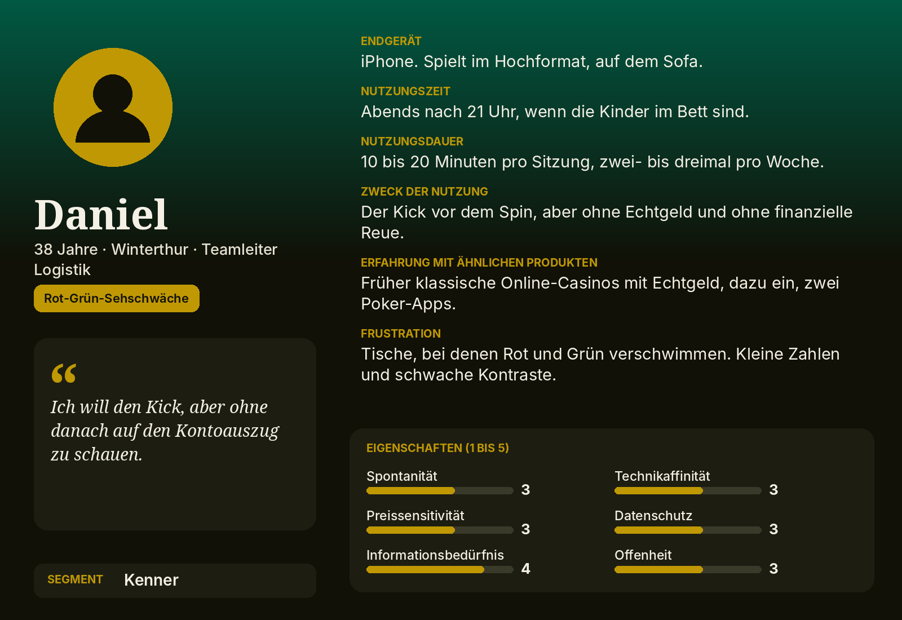

> «Ich will den Kick, aber ohne danach auf den Kontoauszug zu schauen.»

|  |  |
|---|---|
| **Ziel** | Roulette spielen, ohne Echtgeld einzusetzen. Der Reiz soll bleiben, die finanzielle Reue nicht. |
| **Situation** | Hat früher online mit Echtgeld gespielt und will damit aufhören. Nutzt die App abends auf dem Sofa, kurze Sessions von 10 bis 20 Minuten. |
| **Bedürfnisse** | Rot, Schwarz und die Null **sicher** unterscheiden, auch ohne Farbwahrnehmung. Eine klare Oberfläche mit grosser Schrift und eindeutigen Knöpfen. Vor dem Spin sehen, welche Chips gesetzt sind. |
| **Motivation** | Gewohnter Kick, aber ohne Risiko für das Haushaltsbudget |
| **Frustration** | Tische, bei denen Rot und Grün verschwimmen, sodass er sich verklickt. Kleine Zahlen und Chips mit schwachem Kontrast. |

| Eigenschaft | Wert (1 bis 5) |
|---|---|
| Spontanität | 3 |
| Preissensitivität | 3 |
| Informationsbedürfnis | 4 |
| Technikaffinität | 3 |
| Datenschutz | 3 |
| Offenheit | 3 |

**Segment:** Kenner (hohe Casino-Kenntnisse, geringere Nutzungshäufigkeit)

### Segment-Raster

Die beiden Personas lassen sich nach Casino-Kenntnissen (senkrecht) und Nutzungshäufigkeit (waagrecht) einordnen.

|  | Tiefe Nutzungshäufigkeit | Hohe Nutzungshäufigkeit |
|---|---|---|
| **Hohe Casino-Kenntnisse** | **Kenner** (Daniel) | Stammspieler |
| **Tiefe Casino-Kenntnisse** | Gelegenheit | **Einsteiger** (Nico) |

Alle Zahlen in der Nutzeranalyse sind fiktive Annahmen des Auftraggebers.

### Fiktives Interview mit Nico

| Frage | Antwort |
|---|---|
| Auf welchem Gerät spielst du, und wann? | Auf dem iPhone, fast immer abends zwischen 21 und 23 Uhr in meinem Zimmer. |
| Wie lange dauert eine Session? | Etwa eine halbe Stunde, manchmal weniger, wenn ich müde bin. |
| Was reizt dich an Roulette? | Dass alles von einem Moment abhängt. Eine Zahl, ein Spin, fertig. Das sieht man in jedem Stream. |
| Welche ähnlichen Apps kennst du? | Zwei, drei Spielgeld-Casinos aus dem App-Store. Die fragen aber schnell nach Alter oder wollen Chips verkaufen. |
| Was nervt dich an anderen Casino-Apps? | Registrierung, Altersabfrage, ständige Pop-ups mit Angeboten. |
| Wie wichtig ist dir, dass es kein Echtgeld braucht? | Sehr. Ohne Kreditkarte kann ich es einfach ausprobieren, und meine Eltern sehen nichts auf der Abrechnung. |
| Würdest du die App weiterempfehlen? | Ja, wenn sie schnell startet und nicht nervt. Dann zeige ich sie meinen Kollegen. |

### Fiktives Interview mit Daniel

| Frage | Antwort |
|---|---|
| Auf welchem Gerät spielst du, und wann? | Auf dem iPhone, am Abend auf dem Sofa, wenn die Kinder im Bett sind. |
| Wie lange dauert eine Session? | 10 bis 20 Minuten, dann ist es gut. |
| Was reizt dich an Roulette? | Der Moment vor dem Spin. Früher wollte ich diesen Kick mit Geld, heute reicht er mir ohne. |
| Welche ähnlichen Apps kennst du? | Klassische Online-Casinos mit Echtgeld, die ich nicht mehr nutze, und ein, zwei Poker-Apps. |
| Was nervt dich an anderen Casino-Apps? | Dass ich Rot und Grün auf dem Tisch kaum auseinanderhalte. Die Null sieht für mich aus wie eine rote Zahl. Dazu kleine Schrift. |
| Wie wichtig ist dir, dass es kein Echtgeld braucht? | Das ist der Hauptgrund. Ich will nicht mehr nachrechnen, was ich verloren habe. |
| Würdest du die App weiterempfehlen? | Wenn ich sicher setzen kann, ohne mich zu verklicken, ja. |

## 6. Anforderungen

Lucky 37 muss in erster Linie schnell, ohne Hürden und für Rot-Grün-Sehschwäche tauglich sein. Alles, was Einsatz, Spin und Verlauf betrifft, kommt vor Zusatzfunktionen. Die Liste ist nach Wichtigkeit sortiert (Muss, Soll, Kann).

### Funktionale und nichtfunktionale Anforderungen

| Nr. | Anforderung | Art | Priorität | Quelle |
|---|---|---|---|---|
| A1 | Nutzer können einen Einsatz platzieren (Tisch, Wettart, Zahl, Betrag) | funktional | Muss | Nico, Daniel |
| A2 | Eingaben werden validiert (Zahl 0 bis 36, Betrag nicht über Guthaben, Betrag nicht leer), Fehler werden angezeigt, der Nutzer wiederholt die Eingabe, bei korrekter Eingabe erscheint eine Zusammenfassung | funktional | Muss | Daniel |
| A3 | Ein Spin kann ausgelöst und sein Ergebnis angezeigt werden | funktional | Muss | Nico, Daniel |
| A4 | Der Verlauf der letzten Spins und Einsätze ist als Liste sichtbar | funktional | Muss | Daniel |
| A5 | Das Spielgeld-Guthaben ist sichtbar und wird beim Einsatz geprüft | funktional | Muss | Daniel |
| A6 | Der Start erfolgt ohne Registrierung, Konto, Zahlungsdaten und Altersabfrage | funktional | Muss | Nico |
| A7 | Rot, Schwarz und die Null sind nie nur über Farbe erkennbar, sondern zusätzlich über Symbol oder Beschriftung | nichtfunktional (Barrierefreiheit) | Muss | Daniel |
| A8 | Text hat mindestens 4.5:1 Kontrast, Bedienelemente mindestens 3:1 (WCAG 2.2, Stufe AA) | nichtfunktional (Barrierefreiheit) | Muss | Daniel |
| A9 | Touch-Ziele sind mindestens 44 × 44 pt gross, die Bedienung funktioniert im Hochformat einhändig | nichtfunktional (Ergonomie) | Muss | Nico, Daniel |
| A10 | Die App startet in unter 3 Sekunden und zeigt keine Pflicht-Tutorials | nichtfunktional (Performanz) | Muss | Nico |
| A11 | Eine Infoseite nennt Anbieter, Kontakt und Impressum | funktional | Soll | Auftraggeber |
| A12 | Ein FAQ-Bereich erklärt Regeln und Bedienung | funktional | Soll | Daniel |
| A13 | Der letzte Einsatz kann mit einem Tipp wiederholt werden | funktional | Soll | Nico |
| A14 | Der Betrag lässt sich zusätzlich per Slider oder Stepper wählen | funktional | Soll | Daniel |
| A15 | Navigation und Layout sind auf allen Seiten gleich aufgebaut (Tab-Leiste, jede Hauptseite mit höchstens 2 Tipps erreichbar) | nichtfunktional (Konsistenz) | Soll | Nico, Daniel |
| A16 | Die Kugel wird animiert, die Animation lässt sich reduzieren und blinkt höchstens 3-mal pro Sekunde | funktional / nichtfunktional | Kann | Nico |
| A17 | Themes und Töne | funktional | Kann | Auftraggeber |

### Begründung der Sortierung

Die Muss-Anforderungen A1 bis A6 bilden den Kern: Ohne Einsatz, Validierung, Spin, Verlauf und Guthaben gibt es kein Roulette, und ohne Hürden beim Start springt Nico ab. A7 bis A10 sind Muss, weil Daniel das Spiel ohne sie nicht sicher bedienen kann und weil sich eine App für den Abend auf dem Sofa einhändig und ohne Wartezeit anfühlen muss. Die Soll-Anforderungen erleichtern die Nutzung, ohne dass das Produkt sofort unbrauchbar wird, wenn sie fehlen. Animation, Themes und Töne erzeugen Stimmung, tragen aber weder Ziel noch Bedürfnisse der Personas und stehen deshalb ganz unten.

### Bewusst nicht umgesetzt

- **Screenreader-Unterstützung (VoiceOver):** Keine der beiden Personas ist blind oder stark sehbehindert. Die Barrierefreiheit konzentriert sich auf Farbsehschwäche, Kontrast, Touch-Ziele und reduzierbare Animationen.
- **Spielerschutz (Limits, Selbstsperre, Altersprüfung):** Es fliesst kein Echtgeld und es gibt keine Zahlungsfunktion, daher entsteht kein finanzielles Risiko. Der Auftraggeber verzichtet deshalb bewusst auf diese Funktionen. Das Risiko liegt darin, dass auch unter 18-Jährige die App nutzen können (Persona Nico). Das Portfolio hält es als bekannte Folge dieser Entscheidung fest.

## 7. Farbkonzept

Lucky 37 nutzt fünf Grundfarben, die dem Roulette-Tisch folgen, plus drei Neutralfarben für Text, Sekundärtext und Fehler. Die Palette steht in Version 6 fest (Stand 12.11.2026).

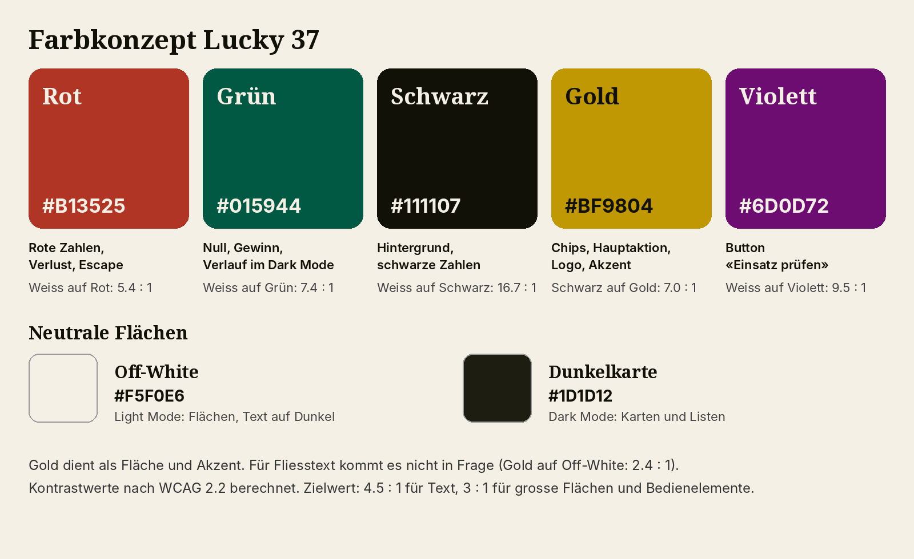

| Farbe | Code | Funktion | Kontrast / Regel |
|---|---|---|---|
| Schwarz | #111107 | Hintergrund, schwarze Roulette-Felder | Gold darauf 6.96, Off-White darauf 16.7 |
| Grün | #015944 | Filz, Feld «0» | Weisser Text darauf lesbar (6.17 bis 10.76 auf den Spielflächen) |
| Rot | #B13525 | Rote Roulette-Felder | Immer mit Rahmen, Zahl und Buchstabe R, nie direkt neben Grün |
| Gold | #BF9804 | Chips, aktiver Tab, Wertsymbole | Nur mit schwarzem Text, nicht für Fliesstext |
| Violett | #6D0D72 | Sekundärfarbe: Navigation und Bonus | Auf Schwarz nur 1.76, deshalb immer mit Goldrahmen |
| Off-White | #F5F0E6 | Text und Hervorhebung | 16.7 auf Schwarz |
| Grau | #8A7F76 | Sekundärtext, inaktive Elemente | Nur für unveränderlichen Hilfetext |
| Hellrot | #FF7A6B | Fehler- und Warnmeldungen | Nur auf Schwarz, immer mit Icon und Text |

**Farbschwäche:** Rot und Grün haben ähnliche Helligkeit, unterscheiden sich im Farbton aber genug: In der Simulation bleiben sie bei Deuteranopie und Protanopie unterscheidbar. Zusätzlich trägt die Farbe nie allein die Information: Rote Felder haben einen Rahmen, die Zahl und den Buchstaben R, schwarze den Buchstaben S, die Null den Buchstaben G. Geprüft mit dem Adobe Color Blindness Simulator (Deuteranopie, Protanopie, Tritanopie).

**Begründung mit Persona-Bezug:** Daniel (38) spielt am Abend auf dem Sofa und unterscheidet Rot und Grün schlecht. Deshalb ist das Tisch-Design nicht auf Farbe allein aufgebaut: Jede Farbfläche trägt zusätzlich Zahl, Buchstabe und Rahmen, und Fehlermeldungen stehen als Hellrot mit Icon auf Schwarz. Nico (17) nutzt die App spät abends im Bett und will nicht auffallen. Das dunkle Theme (#111107) blendet wenig, und das Gold hebt Chips und aktive Elemente hervor, ohne dass die Fläche hell leuchtet. Das Violett grenzt Navigation und Bonus bewusst von den Spielfarben ab, damit beide Personas nie raten müssen, ob ein Element ein Einsatz oder ein Menüpunkt ist.

**Selbstkritik:** Rot und Grün bleiben im Simulator unterscheidbar. Zahl, Buchstabe und Rahmen sind ein zweites Sicherheitsnetz.

## 8. Schriftkonzept

Lucky 37 verwendet zwei Schriften: eine Serifenschrift für Titel und Logo, eine schlichte Sans für Formulare und Text. Beide kennen Umlaute und französische Akzente und haben Fett- und Kursivschnitte.

| Schrift | Quelle | Lizenz | Einsatz |
|---|---|---|---|
| Noto Serif (fett) | [Google Fonts](https://fonts.google.com/noto/specimen/Noto+Serif) | OFL 1.1 | Titel, Logo, Tischnamen |
| Inter | [Google Fonts](https://fonts.google.com/specimen/Inter) | OFL 1.1 | Formulare, Zahlen, Fliesstext, Tab-Leiste |

**Schriftprobe:** Titel in Noto Serif, Fliesstext und Zahlen in Inter, mit Ä, Ö, Ü und é.

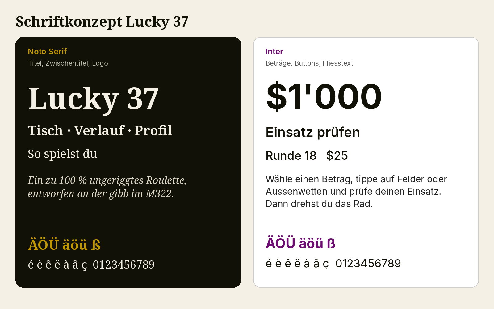

**Icons:** Bootstrap Icons für Pfeile, Hinweise und Aktionen sowie Start, Verlauf und Profil in der Tab-Leiste. Das Roulette-Symbol ist selbst gezeichnet.

**Begründung mit Persona-Bezug:** Daniel liest auf dem Handy am Abend und braucht klare Zahlen: Inter hat gut unterscheidbare Ziffern und bleibt auch klein lesbar, was für Einsatz, Guthaben und Roulette-Zahlen wichtig ist. Nico nutzt die App einhändig im Bett und scrollt schnell durch Listen. Eine ruhige Sans ohne Schnörkel hilft ihm, den Verlauf auf einen Blick zu erfassen. Die Serifenschrift für Titel und Logo gibt der App das Casino-Gefühl, das beide Personas erwarten, und stellt sich bewusst nicht in den Fliesstext, wo sie stören würde.

## 9. Logo

**Logo:** Eine goldene, abgerundete Kachel (iOS-App-Icon). In der Mitte steht «√37» in dunkler Serifenschrift, darum läuft ein Kranz aus hellen Punkten. Als Aushängeschild dient die Variante «Default» des Icons.

**Varianten:** Das Icon gibt es für den hellen Modus (Default), den Dunkelmodus, als transparentes Icon (Clear, hell und dunkel) und als getöntes Icon (Tinted, hell und dunkel). Alle Varianten haben dieselbe Form und dieselbe «√37» mit Punktering.

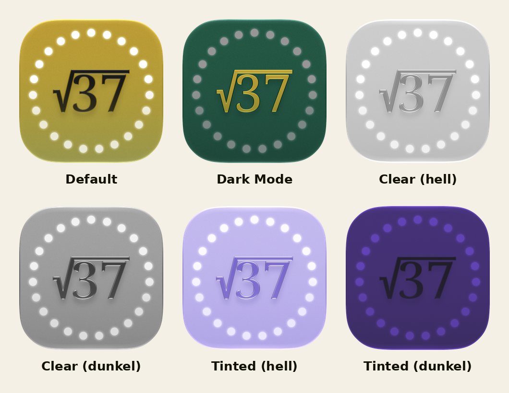

**Begründung mit Persona-Bezug:**

- **37** ist die Anzahl Fächer im europäischen Roulette (0 bis 36). Der Name verweist auf das Spiel, das Wurzelzeichen gibt dem Logo einen mathematischen Touch und macht es einprägsam.
- **Gold** ist die Hauptfarbe der App für Chips und Hauptaktionen. Nico erkennt das Icon auf dem Homescreen, ohne dass es nach Casino aussieht und auffällt.
- Der **Punktering** nimmt den gepunkteten Kranz um den Kontostand auf der Startseite auf. Er braucht weder Rot noch Grün, darum erkennt Daniel das Logo auch mit Rot-Grün-Sehschwäche.
- Die **Serifenschrift** passt zu den Titeln der App (Noto Serif) und wirkt klassisch und ruhig.
- **Kontrast und Grösse:** Dunkle Schrift auf Gold hat 7.0 : 1. Die Zahl steht gross in der Mitte auf einfarbigem Grund und bleibt auch klein erkennbar.
- **Verwendung:** App-Icon auf dem Homescreen und Aushängeschild auf der Titelseite, quadratisch, 1024 × 1024 px.

## 10. Mockups

Die Mockups stammen aus dem Figma-Entwurf und zeigen jeweils den Dark Mode (links) und den Light Mode (rechts).

### Seite 1: Eingabemaske «Tisch»

Auf dem Tisch wählen die Nutzenden eine Zahl oder eine Aussenwette (Rot, Schwarz, Gerade, Ungerade) und einen Chip ($1, $5, $25, $100). Jede Zahl trägt eine Ziffer. Die violette Taste «Einsatz prüfen» führt auf Seite 2.

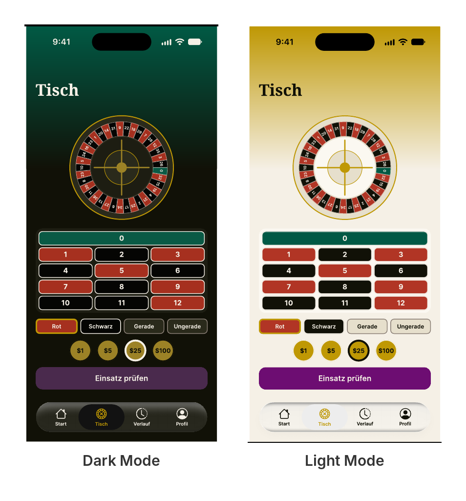

### Seite 2: Ausgabe «Einsatz»

Die zweite Seite wiederholt die Eingaben (Setzt auf: Rot, Einsatz: $25). Mit «Ändern» geht es zurück zum Tisch, mit «Drehen» startet die Runde. Das erste Bild zeigt die Seite ohne Fehler, das zweite die Variante mit der Fehlermeldung «Einsatz über dem Tischlimit (max. $100)» als Kasten mit Symbol und Text. Nach «Drehen» läuft die Runde mit sichtbarem Einsatz weiter (Storyboard, Seite 4).

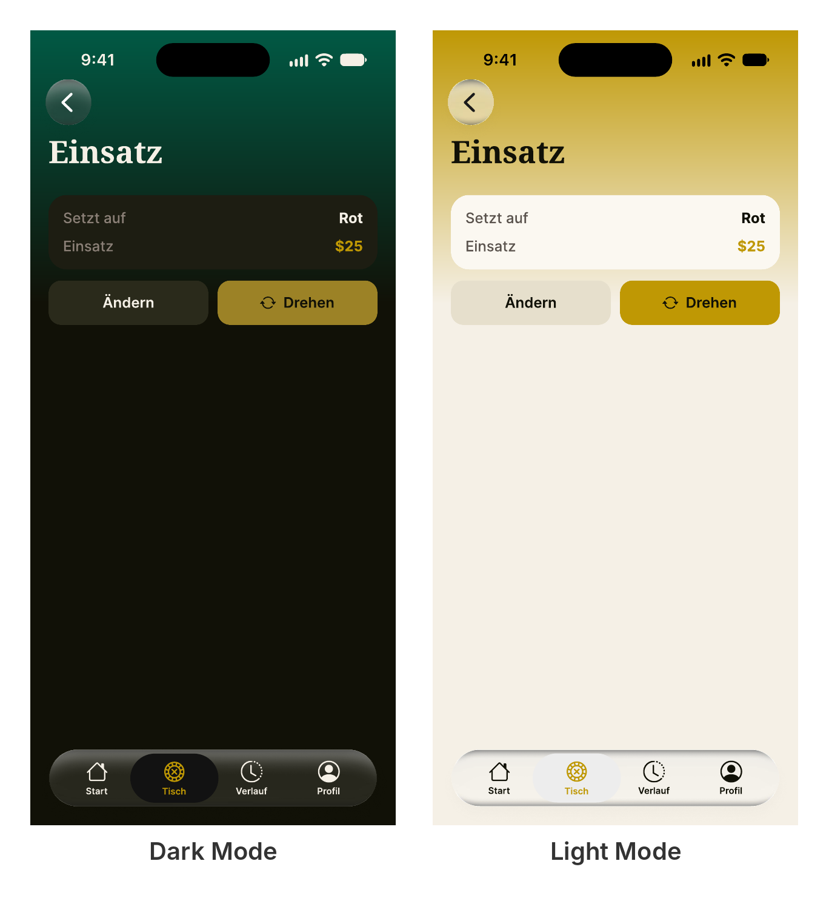

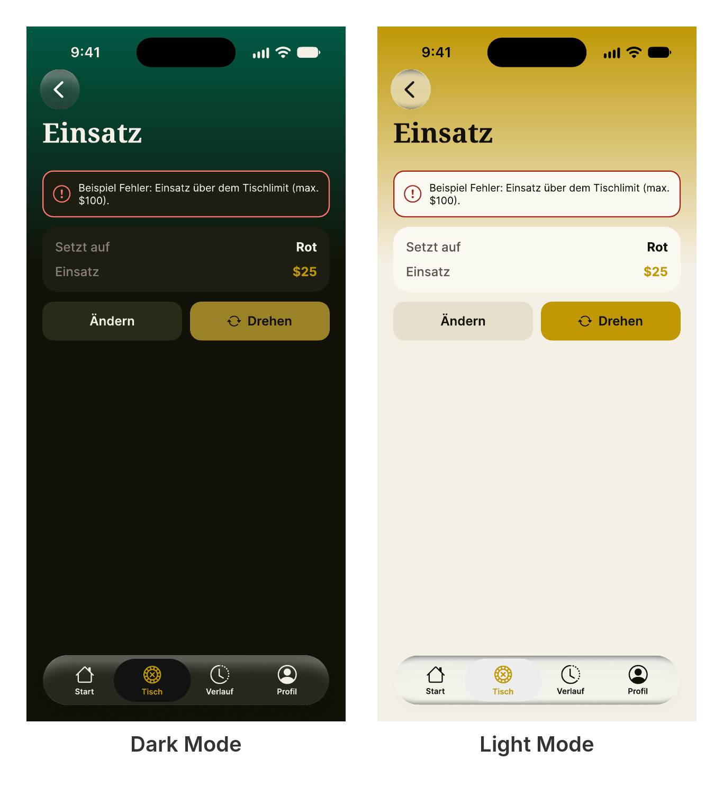

## 11. Storyboard

Das Storyboard zeigt zehn verschiedene Seiten der App. Die Pfeile nennen die Aktion, die zur nächsten Seite führt.

### Spielablauf

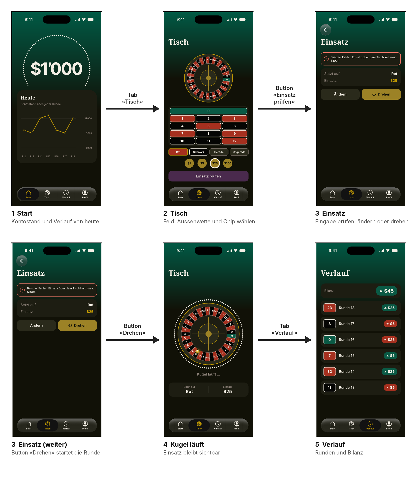

### Profil, Hilfe und Escape

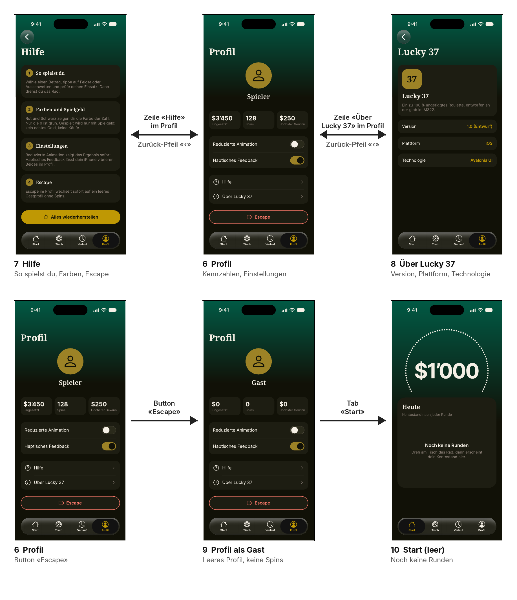

| Seite | Aktion | Ziel |
|---|---|---|
| 1 Start | Tab «Tisch» | Tisch |
| 2 Tisch | Feld, Aussenwette und Chip wählen, dann «Einsatz prüfen» | Einsatz |
| 3 Einsatz | «Drehen» (oder «Ändern» zurück zum Tisch) | Kugel läuft |
| 4 Kugel läuft | Tab «Verlauf» | Verlauf |
| 5 Verlauf | Runden und Bilanz ansehen, Tab-Leiste | alle Tabs |
| 6 Profil | Zeile «Hilfe» | Hilfe |
| 7 Hilfe | Zurück-Pfeil | Profil |
| 8 Profil | Zeile «Über Lucky 37» | Über Lucky 37 |
| 9 Profil | Taste «Escape» | Profil als Gast |
| 10 Profil als Gast | Tab «Start» | Start (leer) |

**Navigation:** Eine Tab-Leiste (Start, Tisch, Verlauf, Profil) ist auf jeder Hauptseite sichtbar, der aktive Tab ist gold hervorgehoben. Unterseiten (Einsatz, Hilfe, Über Lucky 37) haben oben links einen Zurück-Pfeil.

## 12. AI-Deklaration

**Eingesetztes Tool:** Claude Sonnet 5.5 (Anthropic).

| Bereich | Einsatz von Claude Sonnet 5.5 |
|---|---|
| Texte und Struktur der Doku | Vollständig mit Claude erstellt, danach von mir korrigiert |
| Personas | Claude |
| Grafiken (Nutzeranalyse, Personakarten, Farbpalette, Schriftprobe) | Claude |
| Farbkonzept | Palette von mir gewählt und getestet, Kontrastwerte mit Claude berechnet, Begründungstexte von Claude |
| Schriftkonzept | Begründungstexte und Schriftprobe von Claude |
| Logo | Von mir, kein AI-Einsatz |
| Mockups (Figma) | Claude mit Figma MCP |
| Storyboard | Claude |
